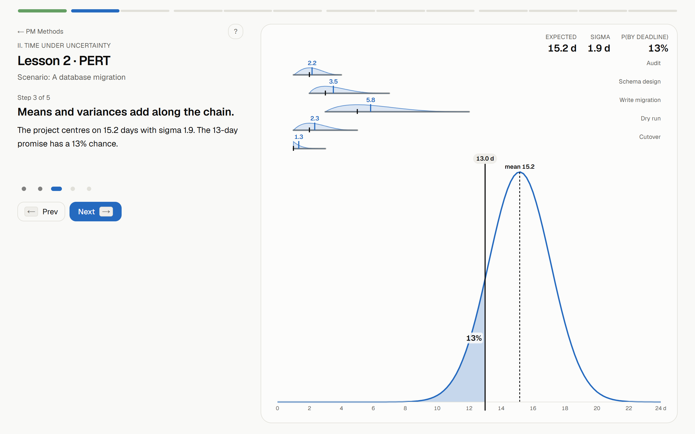

# PM Methods

An interactive course on thirteen project scheduling and flow methods. Each
lesson teaches one method with one scenario, one engine and one interactive
model that changes beat by beat.

## Lessons

| #  | Lesson                                  | Chapter                    | Scenario                     |
| -- | --------------------------------------- | -------------------------- | ---------------------------- |
| 1  | Critical Path Method                    | I. The baseline            | Opening a coffee shop        |
| 2  | PERT                                    | II. Time under uncertainty | A database migration         |
| 3  | Monte Carlo Schedule Simulation         | II. Time under uncertainty | A conference launch          |
| 4  | Fast Tracking                           | III. Going faster          | Building a house             |
| 5  | Project Crashing                        | III. Going faster          | A trade show booth           |
| 6  | Design Structure Matrix                 | III. Going faster          | Developing a bike            |
| 7  | Resource Leveling                       | IV. Limited people         | Three features, one designer |
| 8  | Resource-Constrained Project Scheduling | IV. Limited people         | A game jam team              |
| 9  | Critical Chain (CCPM)                   | IV. Limited people         | A website redesign           |
| 10 | Theory of Constraints                   | V. Flow, not tasks         | A bakery line                |
| 11 | Drum-Buffer-Rope                        | V. Flow, not tasks         | A machine shop               |
| 12 | Kanban and WIP Limits                   | V. Flow, not tasks         | A product team board         |
| 13 | Value Stream Mapping                    | V. Flow, not tasks         | Hiring an engineer           |

## How a lesson is built

Each lesson is four layers, each in its own folder:

1. **Engine** (`src/engine/<slug>`): pure functions that compute the method on
   the lesson's scenario, with Vitest tests that pin the numbers.
2. **Scene** (`src/scenes/<slug>`): one interactive model that takes the current
   beat and the engine's results, wrapped in `SceneFrame` (readouts top-right,
   controls bottom, an `aria-label` that describes the current state).
3. **Beats** (`src/content/lessons/<slug>.tsx`): five or so steps of copy. Each beat
   changes one thing in the scene, and every number in the copy comes from the
   engine.
4. **Check** (same file): one question on the last beat that marks the lesson
   complete.

`LessonShell` runs the beats, keeps the scene mounted, saves progress to
`localStorage` and links lessons together.

## Scripts

| Command           | What it does                              |
| ----------------- | ----------------------------------------- |
| `pnpm dev`        | Development server (webpack)              |
| `pnpm build`      | Production build (webpack)                |
| `pnpm start`      | Serve the production build                |
| `pnpm lint`       | ESLint                                    |
| `pnpm typecheck`  | TypeScript, no emit                       |
| `pnpm test`       | Vitest engine and utility tests           |
| `pnpm test:watch` | Vitest in watch mode                      |
| `pnpm e2e`        | Playwright smoke test of every lesson (builds and serves on port 3300; set `E2E_BASE_URL` to test a running server) |

The build uses webpack because Turbopack needs Next's native SWC binary, which
Windows Smart App Control blocks on the authoring machine. Tailwind runs
through PostCSS (`postcss.config.mjs`), so both bundlers work.

## Folder layout

| Path                  | Contents                                                        |
| --------------------- | --------------------------------------------------------------- |
| `src/app`             | Routes: `/`, `/learn/[slug]`, Open Graph images, sitemap, robots |
| `src/components`      | The lesson shell, scene frame, check card and UI primitives     |
| `src/content`         | Lesson metadata, the lesson registry and one module per lesson  |
| `src/scenes/<slug>`   | Each lesson's interactive model                                 |
| `src/engine/<slug>`   | Each lesson's pure computation, with tests                      |
| `src/lib`             | Shared utilities: random numbers, statistics, formatting, progress, line simulator |
| `tests/e2e`           | Playwright smoke test                                           |

## Quality bar

Every lesson is checked against this list. The phase 16 review is in
[docs/plan/review-log.md](docs/plan/review-log.md).

- **Copy.** A beat title states the takeaway in at most eight words. A beat body
  is at most two sentences and forty words. A term appears in copy only after
  the scene has shown it. Every number in copy is read from the engine at
  render time.
- **Scene.** One focal change per beat. The canvas persists across beats and
  animates its change; it never remounts. The thing being explained is the
  largest element. Readouts sit top-right, controls bottom, and controls only
  mount on beats that use them. Labels and numbers are the only text inside a
  scene.
- **Motion.** Position and size use `type: "spring", bounce: 0.2, visualDuration: 0.4`.
  Opacity uses 180 ms ease-out. Staggers are at most 30 ms per item. Nothing
  except playback runs longer than 600 ms. Only transforms, opacity, `layout`
  and SVG path data animate. `MotionConfig reducedMotion="user"` is respected
  and every beat change still reads without motion.
- **Interaction.** Every control has a visible label, a unit and keyboard
  operation. Sliders snap to whole units unless stated otherwise. Anything the
  learner can break has a Reset.
- **Accessibility.** Each scene exposes an `aria-label` that summarises its
  current state. Readout groups are `aria-live="polite"`. Colour is never the
  only channel: critical items are also thicker, overloads are hatched,
  feedback marks use a different glyph.
- **Performance.** Engines run in `useMemo` or `startTransition`. Per-frame code
  allocates nothing. Any interaction recomputes in under 50 ms on a laptop.
